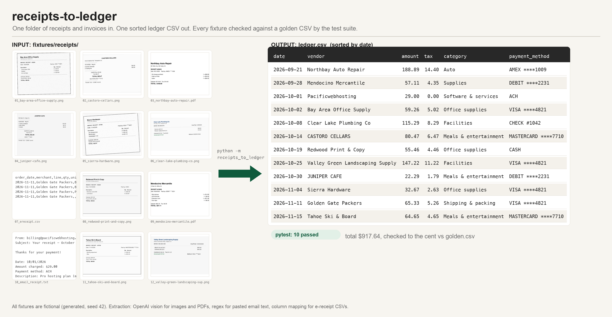

# receipts-to-ledger

Turn a folder of receipts and invoices into one accountant-ready ledger CSV.



## What it does

Point it at a folder. Each file becomes one row in `ledger.csv`:

| file type | how it is read |
| --- | --- |
| PNG / JPG | OpenAI vision model with a strict JSON schema |
| PDF | first page rendered to an image, then the same vision path |
| .txt (pasted confirmation email) | regex parse of the date, amount, and payment lines |
| .csv (e-receipt export) | column mapping to the canonical fields |

Output columns: `date, vendor, amount, tax, category, payment_method`, sorted by date. A run report prints to stdout: files processed, failures, and totals.

Categories come from a keyword rules list (see `receipts_to_ledger/categorize.py`). They are free, deterministic, and easy to edit to match a chart of accounts.

## Quickstart

```bash
python -m venv venv && source venv/bin/activate
pip install -r requirements.txt
export OPENAI_API_KEY=sk-...   # from platform.openai.com
python -m receipts_to_ledger ./path/to/receipts -o ledger.csv
```

Requires Python 3.9+. Each image or PDF is one vision request; a folder of 12 receipts typically costs a few cents on gpt-4o-mini.

## How the test suite works

```bash
pytest -q
```

`tests/test_fixtures.py` runs the full pipeline on `fixtures/receipts/` (12 fictional files: photos in three layouts with rotation and noise, two PDFs, one e-receipt CSV, one pasted email) and compares the result with `fixtures/golden.csv`:

- amounts and tax exact to the cent
- dates exact after normalization
- vendor names fuzzy-matched at 0.85 or higher
- payment methods exact, character for character
- a category present for every row
- rows sorted by date, canonical column order

The fixtures are generated with a fixed seed, so the expected values never change. When a test fails, the fix goes into the extraction prompt or parsing code, never into the assertions.

The tests call the OpenAI API (about 10 vision requests per run), so they need `OPENAI_API_KEY` set. Without it they skip with a message instead of failing.

## Limits (v0)

Stated plainly:

- One receipt per file. A photo of five receipts on a table will not be split into five rows.
- PDFs use the first page only. Multi-page invoices are not handled.
- English only.
- Extraction accuracy depends on image quality. Blurry or heavily angled photos can produce wrong amounts. Small print such as masked card numbers is where misreads happen most often, which is why the tests check payment strings character for character.
- Categories come from a fixed keyword list and will not match every chart of accounts without edits.
- This tool does not replace an accountant's review.

## Regenerating the fixtures (optional)

```bash
pip install Pillow reportlab
python fixtures/generate_fixtures.py
```

All fixture data is fictional and generated with seed 42.

## License

MIT
